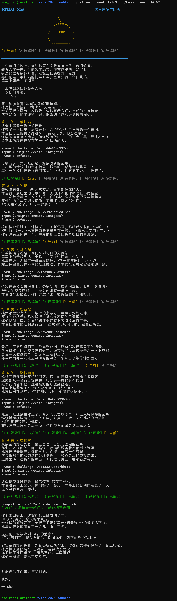
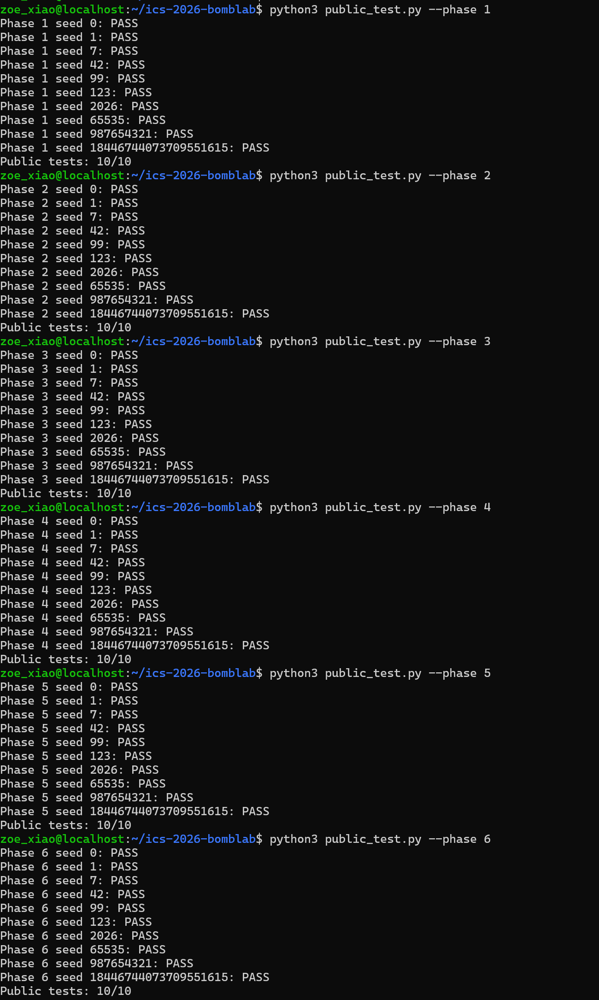

# BombLab 实验报告

> 肖子仪 25300730061
> 仓库：`1901554196-hash/ics-2026-bomblab`  

## 1. 实验目标与环境

本实验通过分析 BombLab 可执行文件的 x86-64 汇编，恢复六个常规阶段的输入计算关系，并在 `defuser.c` 中实现求解器。另尝试分析可选 Honor 阶段的输入检查和答案计算。

- 环境：WSL，Linux x86-64
- 编译器：GCC，C11
- 主要工具：`objdump`、GDB、Git、课程提供的 `public_test.py`

## 2. 分析方法

每一关按以下步骤进行：先用 `objdump` 定位对应函数和辅助函数；再根据 x86-64 调用约定识别参数寄存器；结合 `mov`、`lea`、`shr`、`shl`、`xor`、`add`、`cmp`、条件跳转和间接跳转恢复数据流及控制流；最后将关系翻译为固定宽度无符号整数运算并用公开测试验证。

## 3. 各阶段的汇编依据、计算关系与推理

### Phase 1：整数变换

**关键汇编线索：** `p1_compute` 调用 `p1_step2`、`p1_step0`、`p1_step1`。辅助函数中可见 `shr $0x20`、`shr $0x10`、`lea`、`xor` 和按比例寻址的 `lea`。例如 `lea (...,%rdi,8)` 表示形成 `rdi + 8*rsi` 一类的线性组合；`xor $常量` 表示与常量异或。

令 `c` 为 challenge，低 32 位为 `lo`、高 32 位为 `hi`：

```text
lo = (uint32)c
hi = (uint32)(c >> 32)
t2 = (lo + 0xCE2A) XOR hi
t0 = (lo + 8 * (uint32)(c >> 16)) XOR 0xCDB2
answer = 4 * t0 + (t2 XOR 0x6AE4)        (mod 2^32)
```

**推理过程：** 先把 `challenge` 拆为低、高 32 位；再将 `p1_compute` 中每次函数调用的输入和返回值对应到辅助函数的寄存器运算。最后将返回值代回组合表达式，得到唯一输出整数。

**阶段输出：** 一个无符号十进制整数。

### Phase 2：六个整数

**关键汇编线索：** `phase_02` 先调用 `valid_u32_fields`，再调用 `sscanf` 读取 6 个整数；循环中的 `shr` 和 `and $0xf` 从 challenge 提取 4 位字段，循环计数最终到 6。

```text
v[0] = ((((uint32)(challenge >> 21)) * 2) & 0xff) + 20

对 i = 1..5：
    part = ((uint32)(challenge >> (i + 12))) & 0xf
    v[i] = 5 * ((part + i) XOR v[0])          (mod 2^32)
```

**推理过程：** `and $0xff` 保留低 8 位，`and $0xf` 保留低 4 位；循环每次计算一个后续字段。由于校验函数要求 6 个字段，因此 `count` 设为 6。

### Phase 3：分派表

**关键汇编线索：** `phase_03` 将索引限制在 0–7，`p3_dispatch` 通过间接跳转表选择 `p3_case_0` 至 `p3_case_7`。每个 case 的 `lea`、`xor`、移位和加法构成不同计算。

```text
index = challenge & 7
x = (uint32)(challenge >> 3) XOR (uint32)(challenge >> 32)
v[0] = index
```

第二个字段按索引计算：

| index | `v[1]` |
|---:|---|
| 0 | `5*x + 0x687` |
| 1 | `(x XOR 0xEFE4) + (x >> 1)` |
| 2 | `(4*x) XOR 0xB840` |
| 3 | `5*x + 0xF901` |
| 4 | `(4*x) XOR 0x8950` |
| 5 | `(x XOR 0xC860) + (x >> 1)` |
| 6 | `4*x + 0x18A0` |
| 7 | `5*x + 0x188E4` |

所有结果均按 32 位无符号数计算。`lea disp(base,index,scale)` 可还原为乘法与加法的组合，例如 `lea 0x687(%rdi,%rdi,4)` 等价于 `5*x + 0x687`。

### Phase 4：递归二分路径

**关键汇编线索：** `phase_04` 检查输入字段后调用 `p4_walk`；`p4_walk` 计算 `mid = low + (high-low)/2`，比较 target 与 mid，并递归进入左半区或右半区。返回值经过乘 5、异或及常量组合。

```text
target = (uint32)challenge & 0x7f
key = (uint32)(challenge >> 7) XOR (uint32)(challenge >> 32)
```

递归关系（均按 `uint32_t` 运算）：

```text
mid = low + (high - low) / 2
若 target == mid： return (mid + 0x7B) XOR key
若 target < mid：
    sub = walk(target, low, mid - 1, key)
    return (5*sub XOR (mid + key)) XOR 0x1E
否则：
    sub = walk(target, mid + 1, high, key)
    return (5*sub XOR (mid + key)) XOR 0x0D
```

初始区间为 `[0,127]`。推理时从比较跳转恢复递归方向，再从返回路径中的乘法和异或常量还原递归返回表达式。

### Phase 5：节点遍历

**关键汇编线索：** `phase_05` 读取两个字段并调用 `p5_traverse`。遍历函数用索引访问只读数据表；循环中的节点递增和条件跳转控制遍历次数，`xor` 与 `add` 更新累积值。

求解器使用从二进制只读数据和相关 case 逻辑恢复的两张常量表 `node_a`、`node_b`。主要状态关系为：

```text
current = challenge & 7
steps = (challenge >> 3) & 3
result = ((uint32)(challenge >> 6)
          XOR (uint32)(challenge >> 32)
          XOR node_a[current] XOR 0xD2A5)
         + node_b[current]
```

随后按汇编的循环次数前进到下一个节点，对每个访问节点依次执行 `result ^= node_a[current]`、`result += node_b[current]`。第二个输出字段记录相应的 `node_b` 值；所有累积仍按 32 位回绕。遍历边界采用公开测试校验，避免把“初始节点”与“后续步数”多算或少算一次。

### Phase 6：两次操作组合

**关键汇编线索：** `phase_06` 从 challenge 提取初始值，以 `ops` 数组选择第一次和第二次操作；`p6_dispatch` 再以间接跳转表分派到 `p6_op_0` 至 `p6_op_5`。汇编中的 `rol`、`ror`、`shl`、`shr`、`lea`、`xor` 对应下表关系。

```text
x = (uint32)(challenge >> 6) XOR (uint32)(challenge >> 32)
first = op[challenge & 7](x)
second_input = first XOR 0x66FE
second = op[(challenge >> 3) & 7](second_input)
answer = second + 0x3C2B                    (mod 2^32)
```

| 操作 | 恢复出的关系 |
|---:|---|
| 0 | `ROL32(x, 7) XOR 0x3428` |
| 1 | `(x + 0xB012) XOR (x >> 7)` |
| 2 | `ROR32(x, 1)` |
| 3 | `((x << 7) + 0x6B76) XOR (7*x)` |
| 4 | `((x >> 7) XOR x) + 0xEFC4` |
| 5 | `(x XOR 0xE881) + 8*x` |

操作编号表为 `{2, 5, 0, 4, 4, 3, 0, 1}`。其中 32 位旋转须将移出的位补回另一端；直接只写单方向移位会丢失位。

## 4. Seed 验证与课程评分

课程公开测试使用固定 seed 列表：`0、1、7、42、99、123、2026、65535、987654321、18446744073709551615`。此外



## 5. 运行结果截图
以下是关卡1到关卡6的运行代码



## 6. Honor 阶段进展与问题

Honor 接口为：

```c
int solve_secret(uint64_t challenge, uint64_t context,
                 char *out, size_t cap);
```

`challenge` 是 Honor challenge，`context` 来自前六关答案。输出必须是 ASCII 单行文本且不含换行；Honor 入口及校验要求需从 `secret_gate`、`secret_copy`、`secret_phase` 中分析。

当前 `solve_secret` 已尝试根据反汇编生成 `OPEN` 标记和三项数字，但公开测试曾为 `0/10`。GDB 在 `secret_phase` 入口断点未命中，完整运行在 Honor 显示“旧档案读取失败”。这表明失败发生在 `secret_phase` 被调用之前或入口路径中，尚不能判定三个数字的计算是否正确。需继续检查 `secret_gate` 收到的字符串、marker 偏移、长度和参数。故 Honor 目前未完成。


## 7. 参考资料

- 课程提供的 BombLab 实验要求、`defuser.h`、`challenge.c`、`public_test.py`、`runner.py` 及配套目标程序：用于了解接口、测试方式和各阶段输入检查。
- GDB 官方文档：[https://www.sourceware.org/gdb/documentation/](https://www.sourceware.org/gdb/documentation/)：用于学习断点、运行程序及查看寄存器/内存。
- CS:APP x86-64 GDB 速查表：[http://csapp.cs.cmu.edu/3e/docs/gdbnotes-x86-64.pdf](http://csapp.cs.cmu.edu/3e/docs/gdbnotes-x86-64.pdf)：用于查询 x86-64 寄存器和 GDB 常用命令。
- Beej's Quick Guide to GDB：[https://beej.us/guide/bggdb/](https://beej.us/guide/bggdb/)：用于辅助理解 GDB 调试流程。
- 知乎专栏延伸阅读：[https://zhuanlan.zhihu.com/p/1961833750619988266](https://zhuanlan.zhihu.com/p/1961833750619988266)：作为补充阅读材料。
- `objdump` 手册：通过终端 `man objdump` 查询反汇编选项和输出格式。
- 使用的辅助工具：GCC 编译、GNU `objdump` 反汇编、GDB 单步/断点调试、Git 版本管理及课程公开测试脚本。Codex 对话助手用于解释命令、汇编和调试并修饰报告中的汇编依据与推理。


